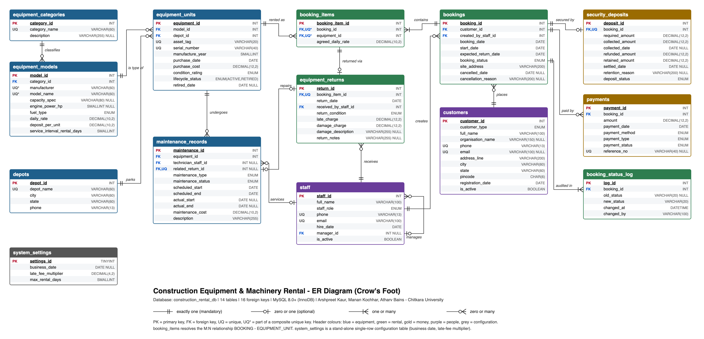

# Construction Equipment & Machinery Rental Management System

A complete MySQL database project for **DBMS (24CSE0209), Chitkara University**. It covers construction equipment, machinery availability, rental bookings, customers, rental periods, rental charges, security deposits, maintenance schedules and equipment return records.

**Team:** Arshpreet Kaur (2510992817) · Manan Kochhar (2510993803) · Atharv Bains (2510993832)



## Quick start (MySQL Workbench)

1. Open MySQL Workbench and connect to your local server (MySQL **8.0.16+**).
2. **File → Open SQL Script → `sql/00_master_setup.sql` → ⚡ Execute.**
   The final grid shows 14 tables, 8 views, 21 routines and 12 triggers.
   ⚠ This script **drops and recreates** `construction_rental_db`. Running it again is the reset.
3. Optional health check: run `tests/verify_database.sql` (expect `DATABASE OK`, 41/41).
4. Live demo: open `sql/10_demo_queries.sql` and run it statement by statement (Cmd+Enter).

Full instructions and troubleshooting: [`docs/WORKBENCH_SETUP.md`](docs/WORKBENCH_SETUP.md).

## What is inside

```
├── README.md
├── sql/
│   ├── 00_master_setup.sql          ONE-FILE INSTALLER (01 + 02 + 06 + 07 + 08), also the reset
│   ├── 01_create_database.sql       14 tables, 16 FKs, 34 CHECKs, indexes
│   ├── 02_seed_data.sql             284 rows of realistic Indian demo data, 15 scenarios
│   ├── 03_basic_queries.sql         SELECT … aggregates, GROUP BY/HAVING, DML (rolled back)
│   ├── 04_joins_and_subqueries.sql  all join types, subqueries, UNION/INTERSECT/EXCEPT
│   ├── 05_advanced_queries.sql      25 business reports
│   ├── 06_views.sql                 8 views
│   ├── 07_procedures_functions.sql  7 functions, 14 procedures (cursor, handlers, locking)
│   ├── 08_triggers.sql              12 triggers
│   ├── 09_transactions.sql          ACID scenarios, SAVEPOINT, two-session instructions
│   ├── 10_demo_queries.sql          classroom demo (read-only part + business transactions)
│   ├── 11_indexing_and_explain.sql  indexes and EXPLAIN
│   └── 12_dcl_security.sql          optional: roles, GRANT, REVOKE
├── diagrams/   ER_Diagram.png / .pdf / .svg / .html   (Crow's Foot)
├── docs/
│   ├── 01_COURSE_REQUIREMENTS.md    CHO analysis and concept mapping
│   ├── 02_ER_MODEL_EXPLANATION.md
│   ├── 03_NORMALIZATION.md          UNF → 1NF → 2NF → 3NF → BCNF
│   ├── 04_INDEXING_AND_OPTIMIZATION.md
│   ├── PROJECT_REPORT.md            28-section report
│   ├── DATA_DICTIONARY.md           every column (generated from information_schema)
│   ├── BUSINESS_RULES.md            every rule and where it is enforced
│   ├── WORKBENCH_SETUP.md
│   └── VIVA_PREPARATION.md          60 Q&A + follow-ups
├── tests/
│   ├── 00_test_helpers.sql          tiny test framework (expected errors don't stop the run)
│   ├── integrity_tests.sql          31 tests
│   ├── business_rule_tests.sql      68 tests
│   ├── financial_tests.sql          44 tests
│   ├── verify_database.sql          41 health checks
│   ├── concurrency_tests.md         two-session Workbench procedure + recorded results
│   ├── concurrency_test.sh          same tests from the command line (optional)
│   └── TEST_RESULTS.md              what was executed and the results
├── references/REFERENCES.md
└── tools/                           developer helpers (rebuild master file / ER diagram)
```

## Key design points (for the viva)

- **Model vs unit:** prices live on `equipment_models`; bookings reference individual `equipment_units`.
- **Availability is derived, not stored:** computed from bookings, returns and maintenance (`vw_equipment_inventory`, `fn_unit_conflict`).
- **No double booking, even under concurrency:** the unit row is locked with `SELECT … FOR UPDATE`, conflicts are re-checked with locking reads, and the same guard is enforced in a trigger. This was tested with real parallel sessions.
- **All-or-nothing bookings:** `sp_create_booking` uses a transaction with an EXIT handler (ROLLBACK + RESIGNAL).
- **Money is exact and consistent:** `DECIMAL` amounts, price snapshots, CHECK-guarded deposit invariants, and no overpayment (trigger).
- **History is protected:** `ON DELETE RESTRICT`; deactivate or retire instead of deleting.
- **Reproducible demo:** the business date is fixed at 2026-11-20 in `system_settings`.

## Running order if you prefer separate files
`01_create_database.sql` → `02_seed_data.sql` → `06_views.sql` → `07_procedures_functions.sql` → `08_triggers.sql`.
Query and demo files (03, 04, 05, 09, 10, 11, 12) run afterwards in any order. Reset with `00_master_setup.sql` after 09/10 if you want the original data back.

## Status
All 143 automated tests and 41 verification checks pass, executed on the team's own MySQL 9.7.1 server with Workbench-style safe-update mode (see `tests/TEST_RESULTS.md`). The SQL targets MySQL 8.0.16+; INTERSECT/EXCEPT demos need 8.0.31+.
