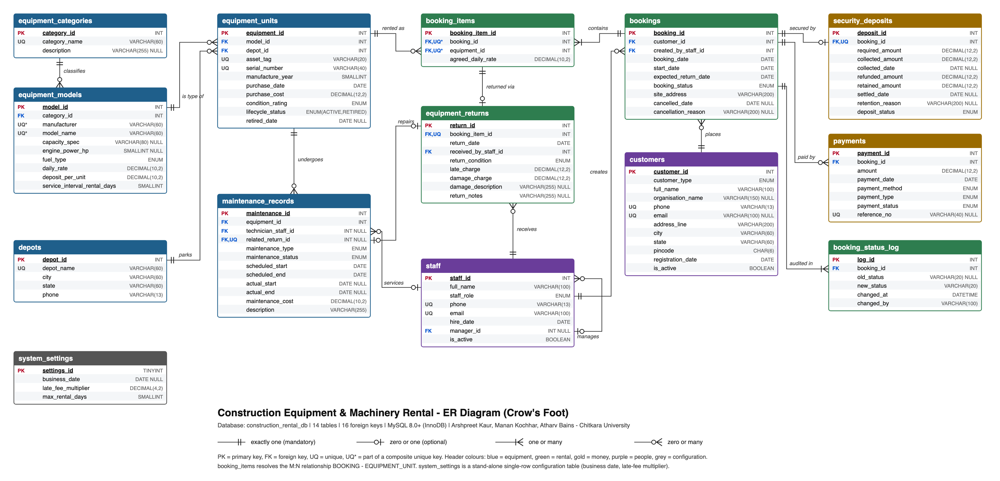

# Construction Equipment & Machinery Rental Management System

### A Relational Database Project in MySQL

**Course:** Database Management System (24CSE0209)
**Programme:** B.E. Computer Science & Engineering (AI & ML), Semester 3, Session July–Dec 2026
**Institute:** Chitkara University Institute of Engineering and Technology, Department of CSE
**Course Coordinator:** Dr. Niharika Thakur

---

## 1. Title page

| | |
|---|---|
| Project title | Construction Equipment & Machinery Rental Management System |
| Database | `construction_rental_db` (MySQL 8.0+, InnoDB, utf8mb4) |
| Tools | MySQL Server, MySQL Workbench |
| Submission | Mini Project / Project Based Evaluation (CHO Component 2) |

## 2. Team details

| Name | University Roll No. |
|---|---|
| Arshpreet Kaur | 2510992817 |
| Manan Kochhar | 2510993803 |
| Atharv Bains | 2510993832 |

## 3. Abstract

Construction companies often rent heavy machinery instead of buying it. A rental business must know at every moment which physical machine is free, booked, out on a site or in the workshop. It must also bill customers correctly, hold and refund security deposits, charge for late or damaged returns and keep the fleet serviced. This project implements that business as a normalised relational database in MySQL. The schema has 14 tables in BCNF, 16 foreign keys and 34 CHECK constraints. Eight views provide the reports, and seven stored functions and fourteen stored procedures implement the business operations: booking, handover, payment, return, deposit settlement, cancellation and maintenance. Twelve triggers enforce rules that span several tables. The central problem, preventing two customers from renting the same machine for overlapping dates, is solved with row-level locking and locking reads, and was verified with real concurrent sessions. The project includes realistic Indian seed data covering fifteen business scenarios, 70 executable demonstration queries, ACID transaction scripts, a live demonstration script and an automated test suite of 143 tests. All tests were executed and passed.

## 4. Introduction

Equipment rental is a classic database application. It combines a catalogue (machine types), an inventory of individually identified assets, time-bound reservations, money (charges, payments and refundable deposits) and maintenance. Each of these maps onto a core topic of our DBMS course: ER modelling, normalisation, integrity constraints, joins and aggregates, views, stored programs, triggers, transactions and concurrency control. The project was built and tested on MySQL with MySQL Workbench as the intended interface.

## 5. Problem statement

The (fictional) company operates three yards (Mohali, Ludhiana, Gurugram) with 32 machines in 11 categories. Rentals are currently tracked on paper slips and spreadsheets. Typical failures of this process:
- the same excavator is promised to two customers for overlapping dates;
- nobody can say quickly which machines are free next week, or which are overdue;
- deposit refunds are forgotten, or more is refunded than was collected;
- late fees are calculated differently by different clerks;
- machines are sent out while due for service, or booked while in the workshop;
- price changes make old invoices impossible to reproduce.

The company needs a database that makes these errors **impossible**, not merely unlikely.

## 6. Objectives

1. Model customers, equipment categories, models, physical units, bookings, payments, deposits, returns and maintenance in a normalised schema (3NF/BCNF).
2. Enforce integrity with keys, CHECK constraints, foreign keys with meaningful referential actions, and triggers.
3. Derive equipment availability from bookings and maintenance instead of storing a fragile status flag.
4. Prevent overlapping bookings of the same unit, including under concurrent access.
5. Implement the rental lifecycle (book → hand over → return → settle) as atomic stored procedures.
6. Provide reports with views and SQL queries covering the course syllabus.
7. Demonstrate transactions and the ACID properties, and verify everything with executable tests.

## 7. Limitations of the existing / manual system

| Manual system | Consequence | Database solution |
|---|---|---|
| Customer details copied on each slip | inconsistent addresses, redundancy | one `customers` row, referenced by FK |
| Machine "status" written on a whiteboard | goes out of date; future bookings invisible | state derived from bookings + maintenance (`vw_equipment_inventory`) |
| No locking when two clerks book | double booking | `FOR UPDATE` row lock + trigger |
| Hand-calculated late fees | disputes | `fn_late_charge`, value validated by trigger |
| Deposits tracked in a register | over-refunds, forgotten refunds | `security_deposits` with CHECK invariants; `vw_pending_deposit_refunds` |
| Price list overwritten | old invoices change | `agreed_daily_rate` snapshot |
| Paper service log | machines rented while due for service | usage-based `vw_maintenance_summary`; maintenance blocks bookings |

## 8. Proposed solution

A MySQL database, `construction_rental_db`, accessed through MySQL Workbench. Business operations are exposed as stored procedures (`CALL sp_create_booking(...)`), reports as views, and every cross-table rule is guarded twice: by the procedure (early, friendly error) and by a trigger (protection against hand-written SQL). A one-file installer (`sql/00_master_setup.sql`) builds the whole system. A fixed *business date* (2026-11-20) keeps the demo scenarios reproducible.

## 9. Project scope

**In scope:** customers; staff; depots; categories, models and physical units; availability checking; bookings with one or more machines; daily pricing with price snapshots; security deposits (collect, hold, refund, retain, forfeit); payments with methods and statuses; partial and late returns; damage charges; maintenance scheduling and tracking; overdue and financial reporting; audit log; role-based access (optional DCL script).

**Out of scope:** GST/tax invoices, weekly/monthly tariffs, operator and transport charges, multi-currency, online payments, a graphical frontend.

## 10. Functional requirements

| ID | Requirement | Implemented by |
|---|---|---|
| FR1 | Register and manage customers | `customers`, Q18–Q21 |
| FR2 | Maintain categories, models and physical units | `equipment_categories`, `equipment_models`, `equipment_units` |
| FR3 | Show each unit's current state | `vw_equipment_inventory` |
| FR4 | Find machines free for a date range | `sp_check_availability`, query B3 |
| FR5 | Create bookings for one or more units, atomically | `sp_create_booking` |
| FR6 | Prevent overlapping bookings and bookings during maintenance | `fn_unit_conflict`, `trg_booking_items_bi` |
| FR7 | Calculate rental charges | `fn_booking_rental_charge`, `vw_booking_financial_summary` |
| FR8 | Collect, hold, settle security deposits | `sp_collect_deposit`, `sp_settle_deposit` |
| FR9 | Record payments | `sp_record_payment` |
| FR10 | Hand over and return machines, including partial returns | `sp_start_rental`, `sp_return_equipment` |
| FR11 | Calculate late fees and record damage | `fn_late_charge`, `equipment_returns` |
| FR12 | Schedule, start, complete maintenance | `sp_schedule_maintenance`, `sp_start_maintenance`, `sp_complete_maintenance` |
| FR13 | Cancel bookings without blocking machines | `sp_cancel_booking` |
| FR14 | Business reports | 8 views, `05_advanced_queries.sql` |
| FR15 | Audit booking status changes | `booking_status_log` + triggers |

## 11. Non-functional requirements

| Category | Requirement |
|---|---|
| Integrity | No orphan rows, no double booking, money invariants always true (verified by `verify_database.sql`) |
| Atomicity | Multi-step operations commit fully or not at all |
| Concurrency | Two simultaneous bookings of the same unit cannot both succeed; different units do not block each other |
| Portability | Runs on standard MySQL 8.0.16+ and Workbench; no external software needed |
| Reproducibility | One-file install/reset; fixed business date |
| Maintainability | Consistent snake_case naming, `pk_`/`fk_`/`uq_`/`chk_`/`idx_` constraint prefixes, commented SQL |
| Security | Optional role-based DCL: procedures via EXECUTE, reports via views |
| Precision | `DECIMAL` for all money |

## 12. Database architecture

- **Engine:** InnoDB for every table (transactions, row locks, foreign keys).
- **Character set:** utf8mb4 / utf8mb4_0900_ai_ci.
- **Layers:** base tables (normalised data) → functions (shared rules) → procedures (business operations) and triggers (rule enforcement) → views (reporting) → optional roles (DCL).
- **Configuration:** `system_settings` holds the business date, the late-fee multiplier (1.5) and the maximum rental length (180 days).

| Object | Count |
|---|---|
| Tables | 14 |
| Foreign keys | 16 |
| CHECK constraints | 34 |
| Secondary indexes (non-PK) | 33 (incl. FK and UNIQUE indexes) |
| Views | 8 |
| Stored functions | 7 |
| Stored procedures | 14 |
| Triggers | 12 |

## 13. ER model

The diagram uses Crow's Foot notation. Key relationships: CUSTOMER 1:N BOOKING; BOOKING M:N EQUIPMENT_UNIT resolved by BOOKING_ITEM; BOOKING 1:0..1 SECURITY_DEPOSIT; BOOKING 1:N PAYMENT; BOOKING_ITEM 1:0..1 EQUIPMENT_RETURN; EQUIPMENT_UNIT 1:N MAINTENANCE_RECORD; STAFF recursive 1:N (manager). The full explanation, including the design alternatives that were rejected, is in [`02_ER_MODEL_EXPLANATION.md`](02_ER_MODEL_EXPLANATION.md).

## 14. Entity descriptions

| Table | Rows (seed) | Description |
|---|---:|---|
| system_settings | 1 | business date and policy values |
| depots | 3 | yards |
| staff | 8 | employees with roles and reporting line |
| customers | 18 | individuals, companies, government departments |
| equipment_categories | 12 | machine families (one deliberately empty) |
| equipment_models | 17 | machine types with list prices |
| equipment_units | 32 | physical machines (1 retired) |
| bookings | 26 | rental agreements in all four statuses |
| booking_items | 47 | machine-in-booking lines with agreed price |
| security_deposits | 23 | deposits in all six statuses |
| payments | 28 | completed, pending, failed and refunded payments |
| equipment_returns | 28 | returns incl. late, damaged and partial |
| maintenance_records | 15 | preventive, corrective, inspection jobs in all statuses |
| booking_status_log | 26 + | audit trail |

Column-level detail: [`DATA_DICTIONARY.md`](DATA_DICTIONARY.md).

## 15. Relational schema

See `02_ER_MODEL_EXPLANATION.md` §4 for the full schema with keys. In short (PK underlined in that document):
`bookings(booking_id, customer_id→customers, created_by_staff_id→staff, booking_date, start_date, expected_return_date, booking_status, …)`,
`booking_items(booking_item_id, booking_id→bookings, equipment_id→equipment_units, agreed_daily_rate)`,
`equipment_returns(return_id, booking_item_id→booking_items UNIQUE, …)`, and so on for all 14 tables.

## 16. Normalization

Starting from the old paper rental slip (UNF, with repeating groups of machines and payments), we derived 1NF (atomic values, key {slip_no, machine_tag}), removed partial dependencies for 2NF (booking facts depend on slip_no only, unit facts on machine_tag only), and removed transitive dependencies for 3NF (customer, staff, model, category and depot facts moved out). Every determinant in the final schema is a candidate key, so it is in **BCNF**. Stored historical values (`agreed_daily_rate`, `late_charge`, `required_amount`) are deliberate snapshots, not redundancy, and derived values (rental days, balances, availability) are computed rather than stored. Full working: [`03_NORMALIZATION.md`](03_NORMALIZATION.md).

## 17. Integrity constraints

| Type | Examples |
|---|---|
| Entity integrity | every table has a PRIMARY KEY |
| Domain | ENUM statuses; `CHECK (phone REGEXP '^\\+91[6-9][0-9]{9}$')`; `CHECK (pincode REGEXP '^[1-9][0-9]{5}$')`; `DECIMAL` money with `CHECK (amount > 0)` |
| Key | UNIQUE asset_tag, serial_number, phone; composite UNIQUE (booking_id, equipment_id); UNIQUE booking_id in deposits and booking_item_id in returns (1:0..1) |
| Referential | 16 FKs: ON DELETE RESTRICT for history, SET NULL for optional staff links, ON UPDATE CASCADE |
| Row-level business rules | `expected_return_date >= start_date`; `start_date >= booking_date`; RETIRED ⇔ retired_date set; deposit status consistent with amounts; GOOD return ⇒ no damage charge; maintenance status ⇔ actual dates |
| Cross-table business rules (triggers) | no overlapping bookings; handover needs a HELD deposit; COMPLETED needs all units returned; no overpayment; retained deposit ≤ amount owed; technician role check |

## 18. SQL implementation

| File | Content | Count |
|---|---|---|
| `01_create_database.sql` | DDL: database, tables, constraints, indexes | 14 tables |
| `02_seed_data.sql` | DML: realistic data covering 15 scenarios | 284 rows |
| `03_basic_queries.sql` | SELECT, WHERE, ORDER BY, DISTINCT, LIMIT, LIKE, IN, BETWEEN, IS NULL, aggregates, GROUP BY/HAVING, INSERT/UPDATE/DELETE (rolled back) | 22 items |
| `04_joins_and_subqueries.sql` | INNER, LEFT, RIGHT, SELF, CROSS, FULL-OUTER emulation; scalar, IN, NOT IN, EXISTS, NOT EXISTS, correlated, derived-table, ALL subqueries; UNION, UNION ALL, INTERSECT, EXCEPT | 24 queries |
| `05_advanced_queries.sql` | 20 required business reports + 5 analytical (utilisation, receivables, trends …) | 25 queries |
| `11_indexing_and_explain.sql` | index catalogue, EXPLAIN, EXPLAIN ANALYZE | 9 sections |
| `12_dcl_security.sql` | roles, GRANT, REVOKE (optional) | 4 roles |

That is **70 executable demonstration queries** in the three query files (21 + 24 + 25; Q22 holds commented-out constraint-violation examples), plus the demo script.

Relational-algebra equivalents of selected queries:

| Query | Relational algebra |
|---|---|
| Q2 active Punjab companies | σtype='COMPANY' ∧ state='Punjab' ∧ active(customers) |
| J1 catalogue | πtag, category, model, depot(units ⋈ models ⋈ categories ⋈ depots) |
| J7 stock matrix | depots × categories (then outer join to units) |
| U1 phone directory | πname,phone(customers) ∪ πname,phone(staff) |
| U3 rented and maintained | πequipment_id(booking_items) ∩ πequipment_id(maintenance_records) |
| U4 never booked | πequipment_id(σactive(units)) − πequipment_id(booking_items) |

## 19. Views

| View | Purpose |
|---|---|
| `vw_equipment_inventory` | every unit with its derived state today (AVAILABLE / RESERVED / ON_RENT / IN_MAINTENANCE / RETIRED), next reservation and next planned job |
| `vw_active_rentals` | machines currently out, days out, days until due |
| `vw_overdue_rentals` | overdue machines with accrued late fee |
| `vw_customer_rental_history` | line-level rental history per customer |
| `vw_booking_financial_summary` | per-booking charges, receipts, balance, deposit (fan-out-safe aggregation) |
| `vw_maintenance_summary` | maintenance history, cost and usage-based service status |
| `vw_equipment_revenue` | revenue vs maintenance cost per unit |
| `vw_pending_deposit_refunds` | HELD deposits of finished rentals, with amount to retain/refund (a view built on a view) |

Date-range availability is deliberately a **procedure**, because views cannot take parameters.

## 20. Stored procedures, functions and triggers

**Functions:** `fn_business_date`, `fn_rental_days`, `fn_unit_conflict` (the single availability rule), `fn_booking_rental_charge`, `fn_late_charge`, `fn_booking_total_charges`, `fn_booking_amount_received`.

**Procedures:** `sp_set_business_date`, `sp_check_availability`, `sp_create_booking` (WHILE-loop parsing, cursor, row locks, all-or-nothing), `sp_collect_deposit`, `sp_start_rental`, `sp_record_payment`, `sp_return_equipment` (late fee, damage, auto-repair scheduling), `sp_settle_deposit`, `sp_cancel_booking`, `sp_schedule_maintenance`, `sp_start_maintenance`, `sp_complete_maintenance`, `sp_overdue_report` (cursor + IF/ELSEIF), `sp_customer_statement`.

**Error handling:** every writing procedure uses `DECLARE EXIT HANDLER FOR SQLEXCEPTION BEGIN ROLLBACK; RESIGNAL; END`, and rules raise `SIGNAL SQLSTATE '45000'` with a readable message.

**Triggers (12):** booking insert/update validation and lifecycle state machine; audit log (after insert/update); the double-booking guard on `booking_items`; return validation and automatic completion; maintenance insert/update conflict and transition checks; payment insert/update (no overpayment, valid transitions); deposit update (final once settled, retention limit). Event, timing, condition and behaviour for each are listed at the top of `08_triggers.sql` and in `BUSINESS_RULES.md`.

## 21. Transactions

`09_transactions.sql` demonstrates:
- **Atomicity:** a successful three-table booking with COMMIT, and a two-machine request where one machine is in the workshop, so ROLLBACK leaves nothing behind (manual and procedure versions);
- **Consistency:** an overpayment refused by a trigger, a refund larger than the deposit refused by a CHECK, and SAVEPOINT / ROLLBACK TO SAVEPOINT;
- **Isolation:** two-session instructions (no dirty read; competing bookings);
- **Durability:** COMMIT, then the redo-log explanation and an optional server-restart check.

**Concurrency control** (syllabus L43–44): the double-booking guard locks the unit row (`SELECT … FOR UPDATE`, an exclusive row lock held until commit, as in two-phase locking), re-checks with locking reads (`FOR SHARE`), and locks multiple units in ascending order to prevent deadlock. Verified with real parallel sessions (`tests/concurrency_tests.md`): the second session waited about 3 s for the first one's lock and was then rejected, while a booking for a different machine finished in about 4 ms.

## 22. Sample data

Realistic, fictional Indian data. Fifteen scenarios are mapped to specific bookings in the header of `02_seed_data.sql`, including: currently rented (B17), future bookings (B22–B24, B26), completed (B1–B11), **overdue** (B18, 4 days), **partially returned** (B18, B19), equipment **in maintenance** (units 5, 13), **scheduled maintenance** (units 12, 18, 21), **fully refunded** deposits, **partially retained** deposits (B4, B5, B10, B11), customer with several bookings (Gill Infrastructure), multi-machine bookings, **late return with charge** (B4, B10), **damage charge** (B5 minor, B11 major with corrective repair), and a **cancelled booking that does not block** its machine (B12, after which B13 rented the same excavator for overlapping dates).

## 23. SQL queries and outputs (actual results on the seed data)

**Overdue rentals (`SELECT * FROM vw_overdue_rentals`):**

| booking_id | customer_name | asset_tag | machine | expected_return_date | days_overdue | agreed_daily_rate | accrued_late_charge |
|---|---|---|---|---|---|---|---|
| 18 | Shivalik Constructions | CER-EXC-003 | Komatsu PC200-8 | 2026-11-16 | 4 | 13000.00 | 78000.00 |

**Fleet state today (`SELECT current_state, COUNT(*) FROM vw_equipment_inventory GROUP BY current_state`):** AVAILABLE 20, ON_RENT 8, IN_MAINTENANCE 2, RESERVED 1, RETIRED 1.

**Rental bill with ROLLUP (B9, booking 17):**

| machine | daily_rate | days | line_total |
|---|---|---|---|
| CER-BHL-001 | 5500.00 | 20 | 110000.00 |
| CER-DMP-001 | 7500.00 | 20 | 150000.00 |
| CER-EXC-001 | 14000.00 | 20 | 280000.00 |
| ** BOOKING TOTAL ** | 27000.00 | 20 | 540000.00 |

**Pending deposit refunds (`vw_pending_deposit_refunds`):**

| booking_id | customer_name | deposit_collected | unpaid_charges | amount_to_retain | amount_to_refund |
|---|---|---|---|---|---|
| 15 | Sharma Builders & Developers | 70000.00 | 0.00 | 0.00 | 70000.00 |
| 16 | Saini Brothers Construction | 35000.00 | 20000.00 | 20000.00 | 15000.00 |

**Equipment due for service (B18):** CER-DMP-001 SERVICE_SCHEDULED (40 rental days / interval 30, job planned 01-Dec), CER-EXC-004 OVERDUE (33/30), CER-CRN-002 OVERDUE (30/30), CER-GEN-001 DUE_SOON (12/15).

**Highest-earning machines (B12):** CER-DOZ-001 BEML BD80 ₹7,70,000; CER-RLR-001 Volvo SD110 ₹5,01,500; CER-EXC-004 Komatsu PC200-8 ₹4,48,500 (includes ₹58,500 late fee).

**Double booking refused (demo 8):**
`ERROR 1644 (45000): Equipment CER-BHL-002 is not available for the requested period (BOOKING_CONFLICT)`

**Late return (demo 10):** JCB due 27-Nov returned 29-Nov → `late_days 2, late_charge 16500.00, booking_status_now COMPLETED`. Deposit settlement → `retained 16500.00, refunded 18500.00, PARTIALLY_REFUNDED`, balance due 0.00.

Every query file states the expected result above each query. These expected results were checked against real execution.

## 24. Testing

| Suite | Tests | Passed |
|---|---:|---:|
| `tests/integrity_tests.sql` | 31 | 31 |
| `tests/business_rule_tests.sql` | 68 | 68 |
| `tests/financial_tests.sql` | 44 | 44 |
| `tests/verify_database.sql` | 41 checks | 41 |
| Concurrency (parallel sessions) | 3 | 3 |

Negative tests run through small helper procedures (`tests/00_test_helpers.sql`) that execute each statement with PREPARE/EXECUTE under a CONTINUE HANDLER, so an expected error is recorded as PASS instead of stopping the file. Test data is marked `TEST:` and removed at the end of each file, so the suites can be re-run. All results were obtained by actually running the scripts on the team's own MySQL 9.7.1 server, with Workbench-style safe-update mode. Details: [`tests/TEST_RESULTS.md`](../tests/TEST_RESULTS.md).

## 25. Limitations

- Daily pricing only; no weekly/monthly tariffs, minimum hire periods, GST, invoices or credit notes.
- One rental period per booking (all machines share the same dates; they may be *returned* at different times).
- No transport/operator/fuel charges and no multi-currency.
- Early returns are billed for the full booked period (a business decision, but some companies refund unused days).
- Usage-based servicing counts rental days, not engine hours.
- Direct SQL by a privileged user can still bypass procedure-only rules such as auto-scheduling repairs after damage. Triggers protect the core invariants, and `12_dcl_security.sql` shows how to restrict ordinary staff to procedures.
- Tested on MySQL 9.7.1 (the version installed on the team's machine); the SQL uses only 8.0-compatible features, but it has not been executed on an 8.0 server. No MySQL Workbench `.mwb` model file is supplied; it can be produced by reverse engineering in a few clicks.

## 26. Future enhancements

- Tariff table (daily/weekly/monthly) and GST-compliant invoices.
- Per-item rental periods and extension requests.
- Engine-hour meter readings on return for true usage-based servicing.
- Customer credit limits and blacklisting.
- MySQL EVENT that emails/SMSes overdue customers daily.
- A web frontend (e.g. a small Flask or Node app calling the existing procedures), which would need no change to the database design.
- GPS/telematics integration for machine location.

## 27. Conclusion

The project turns a paper-based rental process into a database in which the most damaging mistakes cannot happen: double booking, renting a machine that is in the workshop, over-refunding deposits, inconsistent late fees and losing history. It applies the full range of the DBMS syllabus. ER modelling and BCNF normalisation shaped the schema. Constraints and triggers protect it, joins, subqueries, set operations and views produce its reports, and stored programs with cursors and handlers implement its operations. Transactions with row-level locking keep it correct under concurrent use. Every claim in this report is backed by a script that can be executed in MySQL Workbench, and the test suite records that it was.

## 28. References

See [`references/REFERENCES.md`](../references/REFERENCES.md).
